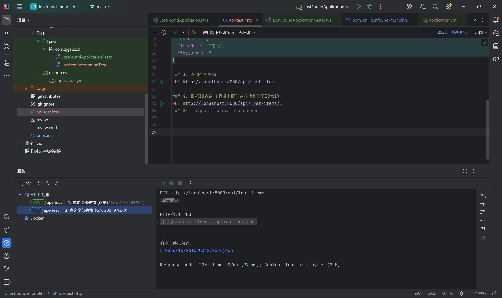
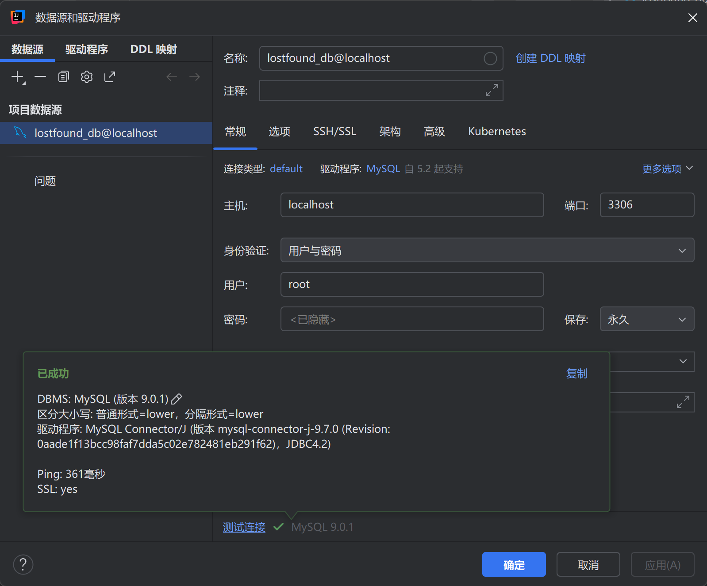

# 第四周作业：单体应用与数据库持久化

## 1. 业务建模

- 核心实体：`User`（用户）与 `LostItem`（失物），关系为 **1 : N**，`lost_items.user_id` 关联 `users.id`。
- 业务流程：用户发布失物 → 默认为 `PENDING`（待审核）→ 可通过列表与详情查询。
- 业务规则：发布时 `feature`（物品特征）不能为空或纯空格；在 `LostItemServiceImpl#createLostItem` 中校验，不通过抛 `IllegalArgumentException`，接口返回 **400** 且不写入数据库。
- 相关文档：`docs/project-proposal.md`、`docs/database.md`。

## 2. 单体应用实现

- 共 4 个 REST 接口，统一前缀 `/api`，资源为 `/api/lost-items`：
  - `GET /api/lost-items` 查询全部
  - `GET /api/lost-items/{id}` 按 ID 查询
  - `POST /api/lost-items` 创建失物
  - `DELETE /api/lost-items/{id}` 删除
- 分层：Controller 只负责 HTTP 输入输出与状态码，业务规则在 Service，数据访问在 Repository（Controller 不直接操作 Repository）。
- 验证结果：正常参数创建返回 `200` 与新建对象；`feature` 为纯空格返回 `400` 与错误提示。

## 3. 数据库持久化

- Spring Data JPA + MySQL：`ddl-auto: update` 自动建表，连接串带 `createDatabaseIfNotExist=true`，首次启动自动建库（库名 `lostfound_db`）。
- 测试数据：`src/main/resources/data.sql` 通过 `INSERT IGNORE` 准备初始用户，可重复执行。
- 初始化顺序：已在 `application.yaml` 中显式启用 `spring.sql.init.mode: always`（MySQL 属外置库，默认不会执行 `data.sql`），并用 `spring.jpa.defer-datasource-initialization: true` 保证建表先于插数据。
- 验证结果：`GET /api/lost-items` 能读到 MySQL 中已持久化的记录。

## 4. 测试与验证

### 运行命令

在 `monolith/` 目录下执行：

```bash
./mvnw test
```

### 测试内容（5 个用例，可重复通过）

| 测试类 | 覆盖点 |
|---|---|
| `LostFoundApplicationTests#contextLoads` | Spring 上下文可加载 |
| `LostItemApiTest`（MockMvc） | API 契约：创建成功 200 且返回 id/status；特征为纯空格返回 400；列表接口返回 JSON 数组 |
| `LostItemIntegrationTest` | Repository 读写 + Service 业务规则拦截 |

### 测试环境隔离

`src/test/resources/application.yml` 将数据源切换为 H2 内存库（`MODE=MySQL`、`ddl-auto: create-drop`），测试方法标注 `@Transactional` 使数据在用例结束后回滚，因此不依赖真实 MySQL 与本地数据。

### 截图





