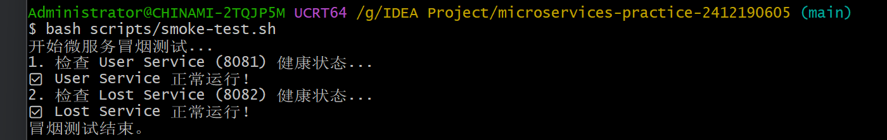

## 服务拆分设计

### 1. 实现思路
*   **业务边界划分**：将原单体工程按业务线拆分为三个核心服务：`user-service`（用户服务，8081）、`lost-service`（失物服务，8082）和 `admin-service`（审核服务，8083）。
*   **数据私有化**：遵循微服务架构原则，每个服务配置独立的数据源（`user_db`、`lost_db`、`admin_db`），在代码层面取消了实体间的物理外键，仅保留关联 ID。
*   **跨服务通信**：`lost-service` 在发布失物时，通过 `RestTemplate` 发送 HTTP 请求至 `user-service` 校验用户合法性；并针对网络调用增加了 `try-catch` 异常捕获，防止因下游服务宕机引发雪崩。

### 2. 运行命令
由于工程被拆分为多模块，需分别在各自的目录下启动：

**启动用户服务 (端口 8081):**
```bash
cd services/user-service
./mvnw spring-boot:run

```

## 代码拆分

### 实现思路
*   在 `services/` 目录下为各个微服务建立独立的 Spring Boot 工程。
*   每个工程包含独立的 `pom.xml`、配置文件、Controller、Service 和测试类。
*   **服务调用与容错**：`lost-service` 将 `user-service` 的地址提取到 `application.yml` 中，通过 `@Value` 注入并支持环境变量覆盖。在 `RestTemplateConfig` 中配置了 3 秒的读写超时，并在 Service 层进行严格校验。如果校验未通过，直接抛出异常，拦截本地数据库写入。

### 验证结果
调用接口测试，当用户存在时发布成功（200），当用户不存在时返回明确错误（400），证明跨服务校验和超时机制生效。
## 本地编排

### 实现思路
*   更新根目录的 `compose.yaml`，实现了 3 个微服务和 3 个独立数据库（user-db, lost-db, admin-db）的一键启动。
*   **数据隔离**：每个服务通过独立账号连接各自的数据库，配置了命名数据卷（Volumes）防止数据丢失。
*   **网络通信**：配置了 `micro-net` 自定义网络，微服务间通过服务名（如 `user-service`、`user-db`）通信，去除了 `localhost` 依赖。

### 运行命令
```bash
docker compose up -d --build
```

## 验证

### 验证脚本
提供了 `scripts/smoke-test.sh` 脚本，通过调用各服务的 `/actuator/health` 接口检查可用性。
运行命令：`bash scripts/smoke-test.sh`
运行结果：


### 跨服务业务流程验证
1. **成功流程**：发送 POST 请求到 `lost-service` (`userId: 1`)，`lost-service` 通过 `RestTemplate` 成功调用 `user-service` 校验用户，随后数据成功写入 `lost_db`，返回状态码 `200`。
2. **失败流程**：发送 POST 请求 (`userId: 999`)，`user-service` 返回 404，`lost-service` 捕获异常并中断后续操作，返回状态码 `400`，且数据库未写入任何脏数据。

### “远端成功、本地失败”窗口说明
在当前的跨服务调用流程中（校验用户 -> 写入本地库），存在微服务架构中典型的**“远端成功、本地失败”窗口**：
当 `lost-service` 调用 `user-service` 校验成功（远端成功）后，如果此时 `lost-service` 的本地数据库突然宕机或发生异常导致写入失败（本地失败），就会出现数据不一致的情况。
**当前处理**：本周实现了基本失败处理（依赖不可用直接拦截）。对于上述极端窗口，由于未引入跨服务原子事务或自动补偿机制，无法直接回滚已完成的远程校验，只能向客户端抛出本地写入异常（HTTP 500）。后续可通过引入 MQ 或 SAGA 分布式事务来解决。