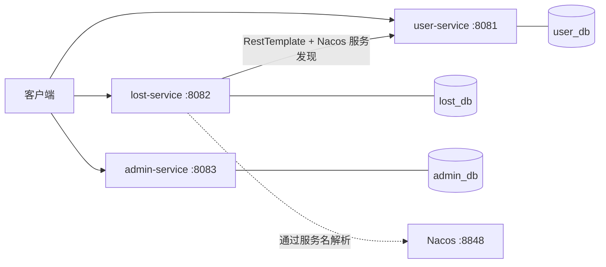

# 第六周作业：微服务拆分与本地编排

## 1. 服务拆分设计

### 1.1 拆分映射（单体 → 微服务）

| 微服务 | 端口 | 独立数据库 | 拥有的表 | 职责 |
|---|---|---|---|---|
| `user-service` | 8081 | `user_db` | `users` | 用户信息查询（供其他服务校验用户） |
| `lost-service` | 8082 | `lost_db` | `lost_items` | 失物发布、查询（发布前跨服务校验用户） |
| `admin-service` | 8083 | `admin_db` | `audit_records` | 审核结论记录（只存失物 ID，不建外键） |

### 1.2 拆分原则

* **按业务能力拆**：用户、失物、审核三条业务线，各自有独立的生命周期与变更频率。
* **数据私有化**：每个服务只读写自己的库，**不跨库建外键、不直连对方的表/Repository**；跨服务只保存对方的 **ID**（`lost_items.user_id`、`audit_records.lost_item_id`）。
* **调用关系**：`lost-service → user-service`（发布失物前校验用户是否存在）；`admin-service` 本周不主动调用其他服务，仅记录审核结论。

### 1.3 架构图



## 2. 代码拆分

### 2.1 目录结构

```text
services/
├── user-service/     # 8081：Controller / Service / Repository / model / 测试
├── lost-service/     # 8082：Controller / Service / client(RestTemplate) / Repository / model / 测试
└── admin-service/    # 8083：Controller / Service / Repository / model / 测试
```

### 2.2 三个服务的分层与测试

| 服务 | Controller | **Service（独立业务层）** | Repository | 自动化测试 |
|---|---|---|---|---|
| user-service | `UserController` | `UserService`（`findById` / `exists` / `findAll`） | `UserRepository` | 6 个用例 |
| lost-service | `LostItemController` | `LostItemService`（跨服务校验 + 落库） | `LostItemRepository` | 5 个用例 |
| admin-service | `AdminController` | `AuditService`（状态白名单 + 防重复审核 + 查询） | `AuditRecordRepository` | 7 个用例 |

**说明**：此前 `user-service` 的 Controller 直接依赖 Repository、`admin-service` 直接用 `EntityManager.persist()`，缺少独立 Service 与查询能力。现已补齐：

* `user-service`：Controller 只调 `UserService`，查询口径（非法 ID 视为不存在）收敛在 Service。
* `admin-service`：新增 `AuditRecordRepository`（含 `findByLostItemId`、`existsByLostItemId`、`findByStatus`），业务规则（`lostItemId` 必填、结论只允许 `APPROVED`/`REJECTED`、同一失物不可重复审核）全部移入 `AuditService`，并补充 `GET /api/admin/audits`、`GET /api/admin/audits/{lostItemId}` 两个查询接口。

### 2.3 跨服务调用实现要点

* `lost-service` 的 `UserClient` 每次调用都向 `DiscoveryClient` 取 `user-service` 的**当前实例**（不在启动时缓存地址）。
* 实例列表为空 → 抛 `UserServiceUnavailableException` → Controller 返回 **503**。
* 对方返回 **404**（用户不存在）→ 视为正常业务结果，返回 `400`，**不写库**。
* `RestTemplateConfig` 配置 3 秒连接/读取超时，避免下游卡死拖垮自身。

### 2.4 测试命令与结果

```bash
cd services/user-service   && ./mvnw test    # 6 passed
cd services/lost-service   && ./mvnw test    # 5 passed
cd services/admin-service  && ./mvnw test    # 7 passed
```

测试统一通过 `@SpringBootTest(properties=...)` 关闭 Nacos 注册并切换 H2 内存库，不依赖真实 MySQL 与注册中心。

## 3. 本地编排（compose.yaml）

### 3.1 服务清单

`user-db` / `lost-db` / `admin-db`（`mysql:8.4.11`）+ 三个业务服务 + `nacos`（`nacos/nacos-server:v3.2.4`）。

### 3.2 关键配置

| 配置 | 做法 |
|---|---|
| 独立数据库 | 每个服务一个库：`user_db` / `lost_db` / `admin_db` |
| **独立业务账号** | 每个库创建专属账号 `user_app` / `lost_app` / `admin_app`（`MYSQL_USER` 只授权本库），服务通过 `DB_USER` + `SPRING_DATASOURCE_PASSWORD` 注入；`root` 仅用于容器初始化与运维 |
| 数据持久化 | 命名卷 `user-db-data` / `lost-db-data` / `admin-db-data` / `nacos-data` / `nacos-logs` |
| 网络通信 | 自定义 bridge 网络 `micro-net`，服务间用**服务名**（`user-db`、`user-service`）访问，不使用 `localhost` |
| 启动顺序 | 数据库配 `healthcheck`，业务服务用 `depends_on: condition: service_healthy` |
| 密钥管理 | 仓库只提交 `.env.example`，真实 `.env` 由 `.gitignore` 忽略 |

### 3.3 启动命令

```bash
cp .env.example .env      # 修改密码与 Token
docker compose up -d --build
docker compose ps
```

## 4. 验证

### 4.1 冒烟脚本

`scripts/smoke-test.sh`（仓库根目录执行）：

```bash
bash scripts/smoke-test.sh
```

覆盖内容：Nacos 控制台页面可访问 + **三个服务**的 `/actuator/health` 全部为 `UP`；任一项失败会累加计数并 **`exit 1`**，全部通过才返回 0。

### 4.2 跨服务业务流程验证

| 场景 | 请求 | 依赖状态 | 响应 | 数据变化 |
|---|---|---|---|---|
| 成功 | `POST /api/lost-items`，`userId=1` | user-service 正常，用户存在 | **200** | `lost_db.lost_items` 新增 1 条 |
| 用户不存在 | 同上，`userId=999` | user-service 返回 404 | **400** | `lost_db` **无新增** |
| 依赖不可用 | 同上 | user-service 实例列表为空/超时 | **503** | `lost_db` **无新增** |
| 审核成功 | `POST /api/admin/audits`，`lostItemId=1, status=APPROVED` | 无外部依赖 | **200** + 记录体 | `admin_db.audit_records` 新增 1 条 |
| 审核非法状态 | `status=DELETED` | — | **400** | `admin_db` 无新增 |
| 重复审核 | 同一 `lostItemId` 再次提交 | — | **409** | `admin_db` 无新增 |

### 4.3 数据变化记录（各库分别看）

| 操作 | user_db.users | lost_db.lost_items | admin_db.audit_records |
|---|---|---|---|
| 初始（`data.sql`） | id=1 `student_zhang` | 空 | 空 |
| 发布失物（`userId=1`） | 不变 | +1（`user_id=1`、`status=PENDING`） | 不变 |
| 发布失物（`userId=999`） | 不变 | **不变** | 不变 |
| 审核（`lostItemId=1`, APPROVED） | 不变 | **不变**（本周不回写状态） | +1（`lost_item_id=1`） |
| 同一失物重复审核 | 不变 | 不变 | **不变**（409 拦截） |

### 4.4 一致性分析

**本周的一致性模型：最终一致，而非强一致。**

1. **无跨库事务**：三个库在不同 MySQL 容器里，本地事务只能保证单库原子性；跨服务调用是两条独立的数据库事务，因此不存在分布式强一致。
2. **无外键约束**：`lost_items.user_id`、`audit_records.lost_item_id` 只是普通列。好处是服务解耦、可独立建库；代价是**数据库层面不会阻止悬挂引用**（例如用户被删而失物仍指向该 ID）。
3. **典型不一致窗口（远端成功、本地失败）**：
   `lost-service` 调用 `user-service` 校验通过（远端成功）→ 本地 `INSERT` 失败（本地失败，如 `lost_db` 宕机或主键冲突）。
   此时远端并未产生任何写入（校验是只读 `GET`），所以**没有脏数据落在 user_db**；但客户端会收到 500，需要重试。
   如果将来把"校验"换成"扣减/占用"这类**写操作**，这个窗口就会产生真正的跨库不一致。
4. **躲避风险的三个措施（本周已做）**：
   * 先校验后写入，校验失败**立即中断**，不产生半成品数据；
   * 依赖不可用返回 **503** 而不是 200，让调用方可安全重试；
   * 审核采用**终态语义**（同一失物不可重复审核，重复提交返回 409），保证多次提交结果一致（幂等）。
5. **已知的不一致缺口（本周明确不解决）**：审核结论只写 `admin_db`，**没有回写 `lost_db.lost_items.status`**，因此"失物状态"与"审核结论"可能暂时不一致；`admin-service` 也未校验 `lostItemId` 在 `lost-service` 中是否真实存在。
6. **后续演进方向**（超出本周要求）：状态回写（审核后调用 `lost-service` 更新状态，失败重试）、本地消息表 / 事务性发件箱、SAGA 补偿、引入 MQ 做最终一致、幂等键。

> 本周要求仅为"顺序流程 + 基本失败处理"，不要求跨服务原子事务、自动补偿或消息机制，以上 5、6 属于后续迭代内容，此处显式记录以免被误读为已实现。
