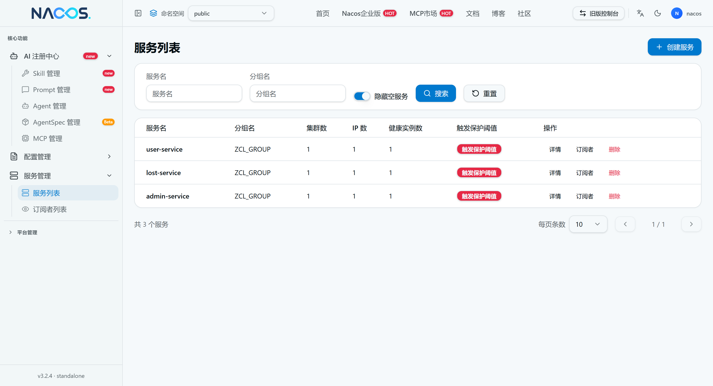
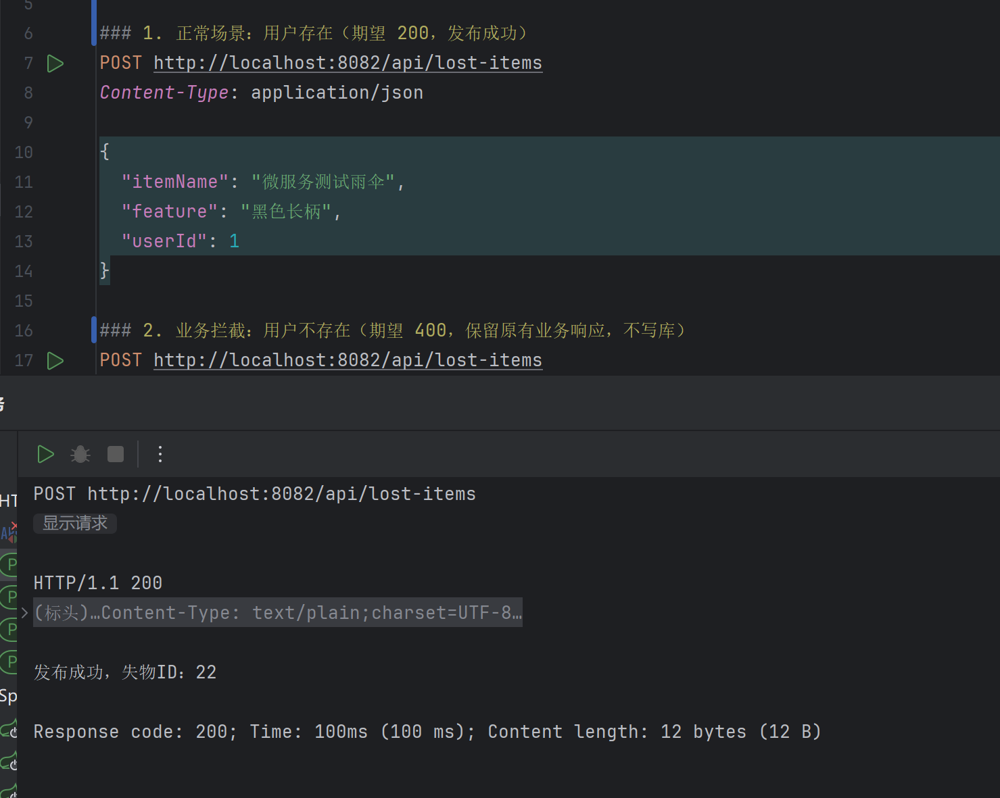
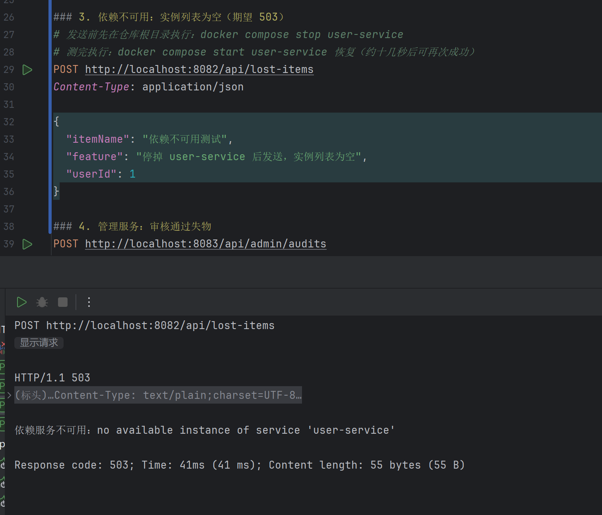

# 第七周：部署 Nacos 并注册服务

本周包含两部分：① 部署 Nacos 并让三个业务服务注册；② 用服务发现完成一次跨服务业务调用。

## 1. 部署内容

在根目录 `compose.yaml` 中新增 `nacos` 服务，镜像为 `nacos/nacos-server:v3.2.4`，单机模式（`MODE=standalone`）。

| 配置项 | 取值 | 说明 |
| --- | --- | --- |
| 镜像 | `nacos/nacos-server:v3.2.4` | 与作业指定版本一致 |
| 运行模式 | `MODE=standalone` | 单机部署 |
| 鉴权 | `NACOS_AUTH_ENABLE=true` | 开启 Nacos 鉴权 |
| Token 密钥 | `NACOS_AUTH_TOKEN` | Base64 字符串，由本地 `.env` 提供 |
| server identity | `NACOS_AUTH_IDENTITY_KEY` / `NACOS_AUTH_IDENTITY_VALUE` | 由本地 `.env` 提供 |
| 数据卷 | `nacos-data` → `/home/nacos/data`；`nacos-logs` → `/home/nacos/logs` | 保证重启后用户、服务数据不丢 |

### 端口规划（控制台 / 服务端 / SDK 三者分离）

| 用途 | 容器端口 | 宿主机端口 | 说明 |
| --- | --- | --- | --- |
| 控制台 UI | 8080 | **18080** | Nacos 3.x 控制台为独立端口，宿主机映射到空闲端口 18080 |
| 服务端 HTTP API | 8848 | 8848 | 服务注册与发现接口 |
| 客户端 gRPC | 9848 | 9848 | SDK 长连接端口（8848 + 1000） |

三个端口均只绑定 `127.0.0.1`，不暴露到局域网或公网。

## 2. 首次初始化（管理员密码）

1. 先单独启动 Nacos：`docker compose up -d nacos`（此时不要同时启动业务服务）。
2. 浏览器打开 <http://localhost:18080>，首次进入会要求初始化管理员密码，用户名固定为 `nacos`。
3. 初始化完成后用该账号登录控制台，并把同一密码写入本机 `.env` 的 `NACOS_PASSWORD`（`compose.yaml` 会把它注入到三个业务服务，供注册时鉴权使用）。

> 真实密码只存在于本地 `.env`，`.gitignore` 已忽略该文件；仓库中仅保留 `.env.example` 占位模板，README、文档和截图均不含明文密码。


## 3. 启动命令（先 Nacos，后业务服务）

```bash
# 1) 先启动 Nacos 并完成上面的初始化
docker compose up -d nacos

# 2) 再构建并启动三个业务服务，启动后自动注册
docker compose up -d --build user-service lost-service admin-service
```

## 4. 服务注册配置

三个服务均在 `src/main/resources/application.yml` 中通过**环境变量**读取 Nacos 地址、凭据与分组：

```yaml
spring:
  application:
    name: user-service        # 分别为 user-service / lost-service / admin-service
  cloud:
    nacos:
      discovery:
        server-addr: ${NACOS_SERVER_ADDR:nacos:8848}
        username: ${NACOS_USERNAME:nacos}
        password: "${NACOS_PASSWORD:}"
        group: ${NACOS_GROUP:ZCL_GROUP}
        register-enabled: true
```

`compose.yaml` 中为三个服务统一注入：

```yaml
      NACOS_SERVER_ADDR: ${NACOS_SERVER_ADDR:-nacos:8848}
      NACOS_USERNAME: ${NACOS_USERNAME:-nacos}
      NACOS_PASSWORD: ${NACOS_PASSWORD}
      NACOS_GROUP: ${NACOS_GROUP:-ZCL_GROUP}
```

要点：

*   **命名空间**：使用默认命名空间 `public`，三个服务一致；未额外创建自定义命名空间，因此不需要填写 Namespace ID。
*   **分组**：个人项目使用 `ZCL_GROUP`（由 `NACOS_GROUP` 注入），三个服务一致，不与课堂示例的默认分组混用。
*   服务名直接使用各自的 `spring.application.name`，与 `docs/microservices-design.md` 一致。
*   容器内访问 Nacos 使用服务名 `nacos:8848`，不能用 `localhost`。
*   宿主发布端口保持 8081 / 8082 / 8083，互不冲突。
*   依赖由 BOM 统一管理：Spring Cloud `2025.1.4` + Spring Cloud Alibaba `2025.1.0.0`，只声明 `spring-cloud-starter-alibaba-nacos-discovery`，不单独覆盖 nacos-client 版本，本周未引入 Config Starter。

> 说明：项目基线是 Spring Boot 4.1.2，原先的 Spring Cloud 2024.0.0 / Spring Cloud Alibaba 2023.0.3.2 分别对应 Boot 3.4 / 3.2 基线，跨大版本无法启动，因此升级到 2025.1.4 / 2025.1.0.0（后者自带 nacos-client 3.1.1，与服务端 3.2.4 匹配）。

## 5. 注册结果

Nacos 控制台「服务管理 → 服务列表」可见 3 个业务服务，实例数均为 1，分组为 `ZCL_GROUP`。

| 服务名 | 分组 | 实例 IP | 端口 | 健康 | 临时实例 |
| --- | --- | --- | --- | --- | --- |
| user-service | ZCL_GROUP | 172.19.0.6 | 8081 | 健康 | true |
| lost-service | ZCL_GROUP | 172.19.0.7 | 8082 | 健康 | true |
| admin-service | ZCL_GROUP | 172.19.0.5 | 8083 | 健康 | true |

实例详情截图：

| 服务 | 截图 |
| --- | --- |
| 服务列表（3 个服务，分组 ZCL_GROUP，实例数均为 1） |  |
| user-service（172.19.0.6:8081） |  |
| lost-service（172.19.0.7:8082） |  |
| admin-service（172.19.0.5:8083） |  |

> 实例 IP 为容器在 `micro-net` 网络内的地址；从宿主机访问服务仍用 8081 / 8082 / 8083。

## 6. 验证方式

```bash
# 容器状态
docker compose ps

# 注册日志（三个服务各一条 register finished）
docker compose logs user-service lost-service admin-service | grep "register finished"
```

三个服务启动日志中的关键输出：

```
nacos registry, ZCL_GROUP user-service 172.19.0.6:8081 register finished
nacos registry, ZCL_GROUP lost-service 172.19.0.7:8082 register finished
nacos registry, ZCL_GROUP admin-service 172.19.0.5:8083 register finished
```

命令行核对（需使用本机 `.env` 中的管理员密码）：

```bash
# 登录取 accessToken
curl -s -X POST 'http://localhost:8848/nacos/v1/auth/login' \
  -d 'username=nacos&password=<本地 .env 中的 NACOS_PASSWORD>'

# 服务列表（Nacos 3.x 控制台管理接口）
curl -s 'http://localhost:8848/nacos/v3/admin/ns/service/list?pageNo=1&pageSize=10&groupName=ZCL_GROUP&namespaceId=public&accessToken=<accessToken>'
```

## 7. 服务发现与业务调用

### 7.1 调用方向与参与者

| 项目 | 取值 |
| --- | --- |
| 调用方 | `lost-service`（宿主端口 8082） |
| 被调用方 | `user-service`（宿主 8081） |
| 暴露的业务接口 | `POST /api/lost-items`（发布失物） |
| 依赖调用的业务接口 | `GET /api/users/{id}`（按 ID 查用户） |
| 命名空间 | `public`（默认，双方一致） |
| 分组 | `ZCL_GROUP`（双方一致） |

业务流程：**发布失物前先校验用户是否存在**；用户不存在或用户服务不可用时，拒绝保存失物记录。

### 7.2 寻址实现（不再使用固定地址）

`services/lost-service/.../client/UserClient.java` 每次业务调用都实时向 `DiscoveryClient` 取实例：

```java
List<ServiceInstance> instances = discoveryClient.getInstances("user-service");
if (instances == null || instances.isEmpty()) {
    throw new UserServiceUnavailableException("no available instance of service 'user-service'", null);
}
ServiceInstance instance = instances.get(0);              // 本周只选一个实例，不做轮询/权重/重试
URI uri = UriComponentsBuilder.fromUri(instance.getUri())  // 用实例的 URI
        .path("/api/users/{id}")                           // 拼原有业务路径
        .buildAndExpand(userId).encode().toUri();
```

*   **不缓存地址**：地址只在本方法内使用，下次请求重新查询，服务上下线后能立即感知。
*   **超时保留**：`RestTemplateConfig` 中连接超时 3 秒、读取超时 3 秒。
*   **错误分层**：
    *   实例列表为空 → `UserServiceUnavailableException` → 控制器返回 **503**；
    *   对方返回 404（用户不存在）→ 视为正常业务结果，保留**原有 400 业务响应**，不写库；
    *   连接失败 / 超时 / 对方 5xx → 同样按依赖不可用返回 **503**。
*   **已删除的固定地址**：`lost-service` 的 `application.yml` 中原有 `user.service.url: ${USER_SERVICE_URL:http://localhost:8081/api/users}` 已删除，`compose.yaml` 也不再注入 `USER_SERVICE_URL`；只保留 Nacos 地址与数据库配置。

控制器映射（`LostItemController`）：

```java
} catch (UserServiceUnavailableException e) {
    return ResponseEntity.status(HttpStatus.SERVICE_UNAVAILABLE).body("依赖服务不可用：" + e.getMessage());
} catch (IllegalArgumentException e) {      // 用户不存在
    return ResponseEntity.badRequest().body(e.getMessage());
}
```

### 7.3 请求示例

```bash
curl -i -X POST http://localhost:8082/api/lost-items \
  -H 'Content-Type: application/json' \
  -d '{"itemName":"校园卡","feature":"蓝色卡套","userId":1}'
```

### 7.4 预期结果与实际结果

| 场景 | 请求 | 预期 | 实际（实测） |
| --- | --- | --- | --- |
| 用户存在 | `userId=1`（`user-service` 中已存在种子用户） | 200，发布成功 | **200**，`发布成功，失物ID：9` |
| 用户不存在 | `userId=999` | 保留原有业务响应，不写库 | **400**，`发布失败：用户不存在或用户服务不可用（校验未通过）` |
| 实例列表为空 | 停止 `user-service` 后请求 `userId=1` | 503 依赖不可用 | **503**，`依赖服务不可用：no available instance of service 'user-service'` |
| 依赖恢复 | 重新启动 `user-service` 后再次请求 | 200，自动恢复 | **200**，`发布成功，失物ID：9` |

补充实测数据：

*   停止 `user-service` 后，Nacos 中该服务实例数**约 3 秒**内变为 0，`lost-service` 下一次调用立即返回 503。
*   重新启动 `user-service` 后，**约 13 秒**（应用启动 + 重新注册）后调用恢复为 200，无需重启 `lost-service`。
*   数据库核对：失败场景（400 / 503）**没有新增 `lost_items` 记录**，只有成功场景落库。

流程截图：

| 场景 | 截图 |
| --- | --- |
| 业务调用成功 |  |
| 依赖不可用返回 503 |  |

### 7.5 空实例测试（不连真实 Nacos）

`services/lost-service/src/test/java/.../client/UserClientTest.java`，用 Mockito 模拟 `DiscoveryClient`、用 `MockRestServiceServer` 模拟下游 HTTP：

| 测试 | 验证内容 |
| --- | --- |
| `throwsWhenInstanceListIsEmpty` | 实例列表为空时抛 `UserServiceUnavailableException`，且不发任何 HTTP 请求 |
| `usesDiscoveredInstanceUriAndOriginalPath` | 用发现到的实例 `http://10.0.0.5:8081` + 原业务路径 `/api/users/1` 发 GET |
| `returnsFalseWhenUserNotFoundButInstancesExist` | 对方 404 时返回 false，不当作依赖不可用 |
| `queriesDiscoveryOnEveryCall` | 两次业务调用触发两次 `getInstances`，证明没有缓存地址 |

## 8. 测试与冒烟脚本

### 单元测试（不依赖真实 MySQL / Nacos）

```bash
cd services/user-service && ./mvnw test
cd services/lost-service && ./mvnw test
cd services/admin-service && ./mvnw test
```

测试类中关闭了 Nacos 注册与发现、用 H2 内存库替代 MySQL。实测（在既无 MySQL、也无法解析 `nacos` 的隔离容器中执行）：

| 服务 | 结果 |
| --- | --- |
| user-service | Tests run: 1, Failures: 0, Errors: 0 → BUILD SUCCESS |
| lost-service | Tests run: 5, Failures: 0, Errors: 0 → BUILD SUCCESS（含 4 个服务发现用例） |
| admin-service | Tests run: 1, Failures: 0, Errors: 0 → BUILD SUCCESS |

### 冒烟脚本（失败返回非零）

```bash
bash scripts/smoke-test.sh
```

覆盖三个服务的 `/actuator/health`；三个正常时退出码 0，任一不可用时退出码 1（均已实测）。

## 9. 本周未做

*   只取实例列表中的第一个实例，未实现轮询、权重路由、自动重试与熔断（按本周要求）。
*   未引入 Nacos Config Starter（按本周要求）。
