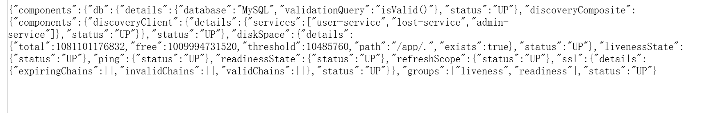
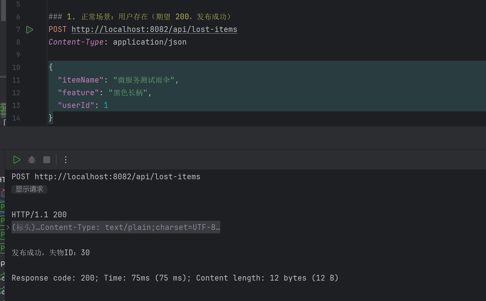

# 第七周：部署 Nacos 并注册服务

本周包含两部分：① 部署 Nacos 并让三个业务服务注册；② 用服务发现完成一次跨服务业务调用。

## 1. 部署内容

在根目录 `compose.yaml` 中新增 `nacos` 服务，镜像为 `nacos/nacos-server:v3.2.4`，单机模式（`MODE=standalone`）。

| 配置项 | 取值 | 说明 |
| --- | --- | --- |
| 镜像 | `nacos/nacos-server:v3.2.4` | 与作业指定版本一致 |
| 运行模式 | `MODE=standalone` | 单机部署 |
| 鉴权 | `NACOS_AUTH_ENABLE=true` | 开启 Nacos 鉴权 |
| Token 密钥 | `NACOS_AUTH_TOKEN` | Base64 字符串，由本地 `.env` 提供 |
| server identity | `NACOS_AUTH_IDENTITY_KEY` / `NACOS_AUTH_IDENTITY_VALUE` | 由本地 `.env` 提供 |
| 数据卷 | `nacos-data` → `/home/nacos/data`；`nacos-logs` → `/home/nacos/logs` | 保证重启后用户、服务数据不丢 |

### 端口规划（控制台 / 服务端 / SDK 三者分离）

| 用途 | 容器端口 | 宿主机端口 | 说明 |
| --- | --- | --- | --- |
| 控制台 UI | 8080 | **18080** | Nacos 3.x 控制台为独立端口，宿主机映射到空闲端口 18080 |
| 服务端 HTTP API | 8848 | 8848 | 服务注册与发现接口 |
| 客户端 gRPC | 9848 | 9848 | SDK 长连接端口（8848 + 1000） |

三个端口均只绑定 `127.0.0.1`，不暴露到局域网或公网。

## 2. 首次初始化（管理员密码）

1. 先单独启动 Nacos：`docker compose up -d nacos`（此时不要同时启动业务服务）。
2. 浏览器打开 <http://localhost:18080>，首次进入会要求初始化管理员密码，用户名固定为 `nacos`。
3. 初始化完成后用该账号登录控制台，并把同一密码写入本机 `.env` 的 `NACOS_PASSWORD`（`compose.yaml` 会把它注入到三个业务服务，供注册时鉴权使用）。

> 真实密码只存在于本地 `.env`，`.gitignore` 已忽略该文件；仓库中仅保留 `.env.example` 占位模板，README、文档和截图均不含明文密码。


## 3. 启动命令（先 Nacos，后业务服务）

```bash
# 1) 先启动 Nacos 并完成上面的初始化
docker compose up -d nacos

# 2) 再构建并启动三个业务服务，启动后自动注册
docker compose up -d --build user-service lost-service admin-service
```

## 4. 服务注册配置

三个服务均在 `src/main/resources/application.yml` 中通过**环境变量**读取 Nacos 地址、凭据与分组：

```yaml
spring:
  application:
    name: user-service        # 分别为 user-service / lost-service / admin-service
  cloud:
    nacos:
      discovery:
        server-addr: ${NACOS_SERVER_ADDR:nacos:8848}
        username: ${NACOS_USERNAME:nacos}
        password: "${NACOS_PASSWORD:}"
        group: ${NACOS_GROUP:ZCL_GROUP}
        register-enabled: true
```

`compose.yaml` 中为三个服务统一注入：

```yaml
      NACOS_SERVER_ADDR: ${NACOS_SERVER_ADDR:-nacos:8848}
      NACOS_USERNAME: ${NACOS_USERNAME:-nacos}
      NACOS_PASSWORD: ${NACOS_PASSWORD}
      NACOS_GROUP: ${NACOS_GROUP:-ZCL_GROUP}
```

要点：

*   **命名空间**：使用默认命名空间 `public`，三个服务一致；未额外创建自定义命名空间，因此不需要填写 Namespace ID。
*   **分组**：个人项目使用 `ZCL_GROUP`（由 `NACOS_GROUP` 注入），三个服务一致，不与课堂示例的默认分组混用。
*   服务名直接使用各自的 `spring.application.name`，与 `docs/microservices-design.md` 一致。
*   容器内访问 Nacos 使用服务名 `nacos:8848`，不能用 `localhost`。
*   宿主发布端口保持 8081 / 8082 / 8083，互不冲突。
*   依赖由 BOM 统一管理：Spring Cloud `2025.1.4` + Spring Cloud Alibaba `2025.1.0.0`，只声明 `spring-cloud-starter-alibaba-nacos-discovery`，不单独覆盖 nacos-client 版本，本周未引入 Config Starter。

> 说明：项目基线是 Spring Boot 4.1.2，原先的 Spring Cloud 2024.0.0 / Spring Cloud Alibaba 2023.0.3.2 分别对应 Boot 3.4 / 3.2 基线，跨大版本无法启动，因此升级到 2025.1.4 / 2025.1.0.0（后者自带 nacos-client 3.1.1，与服务端 3.2.4 匹配）。

## 5. 注册结果

Nacos 控制台「服务管理 → 服务列表」可见 3 个业务服务，实例数均为 1，分组为 `ZCL_GROUP`。

| 服务名 | 分组 | 实例 IP | 端口 | 健康 | 临时实例 |
| --- | --- | --- | --- | --- | --- |
| user-service | ZCL_GROUP | 172.19.0.5 | 8081 | 健康 | true |
| lost-service | ZCL_GROUP | 172.19.0.7 | 8082 | 健康 | true |
| admin-service | ZCL_GROUP | 172.19.0.6 | 8083 | 健康 | true |

实例详情截图：

| 服务 | 截图 |
| --- | --- |
| 服务列表（3 个服务，分组 ZCL_GROUP，实例数均为 1） |  |
| user-service（172.19.0.5:8081） |  |
| lost-service（172.19.0.7:8082） |  |
| admin-service（172.19.0.6:8083） |  |

> 实例 IP 为容器在 `micro-net` 网络内的地址；从宿主机访问服务仍用 8081 / 8082 / 8083。

## 6. 验证方式

```bash
# 容器状态
docker compose ps

# 注册日志（三个服务各一条 register finished）
docker compose logs user-service lost-service admin-service | grep "register finished"
```

三个服务启动日志中的关键输出：

```
nacos registry, ZCL_GROUP user-service 172.19.0.5:8081 register finished
nacos registry, ZCL_GROUP lost-service 172.19.0.7:8082 register finished
nacos registry, ZCL_GROUP admin-service 172.19.0.6:8083 register finished
```

命令行核对（需使用本机 `.env` 中的管理员密码）：

```bash
# 登录取 accessToken
curl -s -X POST 'http://localhost:8848/nacos/v1/auth/login' \
  -d 'username=nacos&password=<本地 .env 中的 NACOS_PASSWORD>'

# 服务列表（Nacos 3.x 控制台管理接口）
curl -s 'http://localhost:8848/nacos/v3/admin/ns/service/list?pageNo=1&pageSize=10&groupName=ZCL_GROUP&namespaceId=public&accessToken=<accessToken>'
```

## 7. 服务发现与业务调用

### 7.1 调用方向与参与者

| 项目 | 取值 |
| --- | --- |
| 调用方 | `lost-service`（宿主端口 8082） |
| 被调用方 | `user-service`（宿主 8081） |
| 暴露的业务接口 | `POST /api/lost-items`（发布失物） |
| 依赖调用的业务接口 | `GET /api/users/{id}`（按 ID 查用户） |
| 命名空间 | `public`（默认，双方一致） |
| 分组 | `ZCL_GROUP`（双方一致） |

业务流程：**发布失物前先校验用户是否存在**；用户不存在或用户服务不可用时，拒绝保存失物记录。

### 7.2 寻址实现（不再使用固定地址）

`services/lost-service/.../client/UserClient.java` 每次业务调用都实时向 `DiscoveryClient` 取实例：

```java
List<ServiceInstance> instances = discoveryClient.getInstances("user-service");
if (instances == null || instances.isEmpty()) {
    throw new UserServiceUnavailableException("no available instance of service 'user-service'", null);
}
ServiceInstance instance = instances.get(0);              // 本周只选一个实例，不做轮询/权重/重试
URI uri = UriComponentsBuilder.fromUri(instance.getUri())  // 用实例的 URI
        .path("/api/users/{id}")                           // 拼原有业务路径
        .buildAndExpand(userId).encode().toUri();
```

*   **不缓存地址**：地址只在本方法内使用，下次请求重新查询，服务上下线后能立即感知。
*   **超时保留**：`RestTemplateConfig` 中连接超时 3 秒、读取超时 3 秒。
*   **错误分层**：
    *   实例列表为空 → `UserServiceUnavailableException` → 控制器返回 **503**；
    *   对方返回 404（用户不存在）→ 视为正常业务结果，保留**原有 400 业务响应**，不写库；
    *   连接失败 / 超时 / 对方 5xx → 同样按依赖不可用返回 **503**。
*   **已删除的固定地址**：`lost-service` 的 `application.yml` 中原有 `user.service.url: ${USER_SERVICE_URL:http://localhost:8081/api/users}` 已删除，`compose.yaml` 也不再注入 `USER_SERVICE_URL`；只保留 Nacos 地址与数据库配置。

控制器映射（`LostItemController`）：

```java
} catch (UserServiceUnavailableException e) {
    return ResponseEntity.status(HttpStatus.SERVICE_UNAVAILABLE).body("依赖服务不可用：" + e.getMessage());
} catch (IllegalArgumentException e) {      // 用户不存在
    return ResponseEntity.badRequest().body(e.getMessage());
}
```

### 7.3 请求示例

```bash
curl -i -X POST http://localhost:8082/api/lost-items \
  -H 'Content-Type: application/json' \
  -d '{"itemName":"校园卡","feature":"蓝色卡套","userId":1}'
```

### 7.4 预期结果与实际结果

| 场景 | 请求 | 预期 | 实际（实测） |
| --- | --- | --- | --- |
| 用户存在 | `userId=1`（`user-service` 中已存在种子用户） | 200，发布成功 | **200**，`发布成功，失物ID：9` |
| 用户不存在 | `userId=999` | 保留原有业务响应，不写库 | **400**，`发布失败：用户不存在或用户服务不可用（校验未通过）` |
| 实例列表为空 | 停止 `user-service` 后请求 `userId=1` | 503 依赖不可用 | **503**，`依赖服务不可用：no available instance of service 'user-service'` |
| 依赖恢复 | 重新启动 `user-service` 后再次请求 | 200，自动恢复 | **200**，`发布成功，失物ID：9` |

补充实测数据：

*   停止 `user-service` 后，Nacos 中该服务实例数**约 3 秒**内变为 0，`lost-service` 下一次调用立即返回 503。
*   重新启动 `user-service` 后，**约 13 秒**（应用启动 + 重新注册）后调用恢复为 200，无需重启 `lost-service`。
*   数据库核对：失败场景（400 / 503）**没有新增 `lost_items` 记录**，只有成功场景落库。

流程截图：

| 场景 | 截图 |
| --- | --- |
| 业务调用成功 |  |
| 依赖不可用返回 503 |  |

### 7.5 空实例测试（不连真实 Nacos）

`services/lost-service/src/test/java/.../client/UserClientTest.java`，用 Mockito 模拟 `DiscoveryClient`、用 `MockRestServiceServer` 模拟下游 HTTP：

| 测试 | 验证内容 |
| --- | --- |
| `throwsWhenInstanceListIsEmpty` | 实例列表为空时抛 `UserServiceUnavailableException`，且不发任何 HTTP 请求 |
| `usesDiscoveredInstanceUriAndOriginalPath` | 用发现到的实例 `http://10.0.0.5:8081` + 原业务路径 `/api/users/1` 发 GET |
| `returnsFalseWhenUserNotFoundButInstancesExist` | 对方 404 时返回 false，不当作依赖不可用 |
| `queriesDiscoveryOnEveryCall` | 两次业务调用触发两次 `getInstances`，证明没有缓存地址 |

## 8. Actuator 健康端点与三种“健康”的区别

三个服务均保留 `spring-boot-starter-actuator` 依赖，并在 `application.yml` 中显式配置：

```yaml
management:
  endpoints:
    web:
      exposure:
        include: health,info
  endpoint:
    health:
      show-details: always
```

实测 `GET http://localhost:8081/actuator/health`（8082 / 8083 相同结构，节选）：

```json
{
  "components": {
    "db": { "status": "UP" },
    "discoveryComposite": {
      "components": {
        "discoveryClient": {
          "details": { "services": "user-service lost-service admin-service" },
          "status": "UP"
        }
      },
      "status": "UP"
    },
    "diskSpace": { "status": "UP" },
    "livenessState": { "status": "UP" },
    "ping": { "status": "UP" },
    "readinessState": { "status": "UP" }
  },
  "status": "UP"
}
```

### 8.1 三种“健康”的区别（以本系统为例）

| 概念 | 在本系统中的体现 | 由谁维护 | 变化条件 |
| --- | --- | --- | --- |
| SDK 连接存活 | `user-service` 内 nacos-client 与 Nacos 服务端（8848 / gRPC 9848）之间的长连接与心跳 | nacos-client 后台心跳线程 | 进程被杀、容器停止、网络断开 → 心跳停止 |
| 注册实例状态 | 控制台「服务列表」中 `user-service` 实例数=1、健康=健康、临时实例=true | Nacos 服务端 | 客户端启动注册（上线）；心跳超时或连接断开后服务端剔除临时实例；或主动注销 |
| Actuator 应用健康 | `GET /actuator/health` 返回 `status=UP`，含 `db`、`diskSpace`、`liveness/readiness` 等组件 | 应用自身的 HealthIndicator | 应用内部组件异常（例如数据库连不上）→ 该接口变 `DOWN` |

要点（作业要求不要误解的地方）：

*   **不要把 Actuator 的 UP/DOWN 当作 Nacos 的注册状态**。本系统中 `/actuator/health` 检查的是应用自身的数据库连通性、磁盘空间、存活/就绪状态，它**不会**向 Nacos 上报；Nacos 列表里是否还有该实例，取决于 SDK 心跳与连接（临时实例）。
*   **Actuator 返回 DOWN 不会自动让 Nacos 摘除实例**。本周**没有**做“健康状态与注册联动”（既没有把 health 结果推给 Nacos，也没有在 DOWN 时调用注销接口），因此即使健康检查失败，实例仍会留在列表里，直到心跳超时或连接断开被服务端剔除。
*   反过来，**服务停止后 Actuator 立即不可访问，而 Nacos 实例是稍后消失的**：实测停掉 `user-service` 后，其 `/actuator/health` 立刻变成连接不可达（容器已停），而 Nacos 中该实例约 **2.2 秒**后才从 1 变为 0。

## 9. 依赖下线、失败与恢复的验证记录

### 9.1 停止与恢复命令

```bash
# 停止被调用方（只 stop，不删除容器，实例 IP 保持不变）
docker compose stop user-service

# 恢复
docker compose start user-service
```

### 9.2 业务请求与数据检查命令

```bash
# 业务请求：每次换新的业务参数，便于判断是否新增记录
curl -i -X POST http://localhost:8082/api/lost-items \
  -H 'Content-Type: application/json' \
  -d '{"itemName":"umbrella-after-actuator","feature":"black-long-handle","userId":1}'

# 数据检查：lost_items 行数
docker exec -e MYSQL_PWD=<本地 .env 中的 MYSQL_ROOT_PASSWORD> \
  microservices-practice-2412190605-lost-db-1 \
  mysql -uroot -D lost_db -e "SELECT COUNT(*) FROM lost_items;"
```

### 9.3 实测过程与结果

| 阶段 | 操作 | 健康接口 | Nacos 实例数 | 业务请求 | `lost_items` 行数 |
| --- | --- | --- | --- | --- | --- |
| ① 全部正常 | — | 8081 / 8082 / 8083 均 `UP` | user=1 lost=1 admin=1 | **200**，`发布成功，失物ID：28` | 27 → **28**（+1，已落库） |
| ② 下线 | `docker compose stop user-service` | 8081 立即不可达；8082 / 8083 仍 `UP` | user 在 **2.2 秒**后变为 0，lost/admin 仍为 1 | — | 28（不变） |
| ③ 失败 | 用新的有效参数再次请求 | — | user=0 | **503**，`依赖服务不可用：no available instance of service 'user-service'` | **28 → 28（+0）**，未绕过校验写库 |
| ④ 恢复 | `docker compose start user-service` | 8081 重新 `UP`（各组件均正常） | user 在 **14.7 秒**后重新变为 1 | — | 28（不变） |
| ⑤ 恢复后复查 | 再次发起同样请求 | 8081 `UP` | user=1 | **200**，`发布成功，失物ID：29` | 28 → **29**（+1，已落库） |

结论：

*   **依赖校验失败不会新增本地记录**：③ 阶段返回 503，`lost_items` 行数保持 28，说明没有跳过校验、也没有部分写入。
*   **恢复后无需重启调用方**：④ → ⑤ 期间 `lost-service` 未重启，请求直接恢复成功，因为每次请求都实时向 `DiscoveryClient` 取实例地址。
*   **不存在“旧地址连接失败”窗口**：由于不缓存地址，实例被摘除后下一次请求直接看到空列表并返回 503（`no available instance`），不会拿旧 IP 去连接；若缓存了旧地址，才会出现“连接被拒绝/超时”这类错误。
*   **事务边界**：③ 的失败发生在 `entityManager.persist()` 之前，因此本地无写入；但本周**未实现**分布式事务或自动补偿——若跨服务调用成功、本地提交前失败，仍存在部分成功的窗口（按作业要求不实现补偿）。

截图：

| 场景 | 截图 |
| --- | --- |
| 应用健康接口（`/actuator/health`） |  |
| 下线后失败（503） |  |
| 恢复后成功（200） |  |

## 10. 冒烟脚本与单元测试

### 10.1 冒烟脚本 `scripts/smoke-test.sh`（在仓库根目录执行）

```bash
bash scripts/smoke-test.sh
```

检查项（共 **4 项**，**任一失败即以非零状态退出**，不会忽略错误后仍报成功）：

| # | 检查项 | 通过条件 |
| --- | --- | --- |
| 1 | Nacos 控制台页面可访问 | `http://localhost:18080`（容器 8080 → 宿主 18080，**不是旧版 `8848/nacos`**）返回控制台 HTML 页面；脚本会跟随 3.x 控制台 `/` → `/next/` 的 302 跳转，并校验响应是含 `<title>` 的控制台页面 |
| 2 | `user-service` 健康接口 | `http://localhost:8081/actuator/health` 响应含 `"status":"UP"` |
| 3 | `lost-service` 健康接口 | `http://localhost:8082/actuator/health` 同上 |
| 4 | `admin-service` 健康接口 | `http://localhost:8083/actuator/health` 同上 |

实测退出码（4 种场景都验证过）：

| 场景 | 关键输出 | 退出码 |
| --- | --- | --- |
| 全部正常 | `冒烟测试通过：4 项检查全部正常` | **0** |
| 控制台地址错误（`NACOS_CONSOLE_URL=http://localhost:18999`） | `[FAIL] Nacos 控制台不可访问…` | **1** |
| 误用旧版 `8848/nacos` 地址 | `[FAIL] …或不是控制台页面` | **1** |
| 停掉 `admin-service` 后运行 | `[FAIL] admin-service (8083) 健康接口不可用或状态非 UP` | **1** |
| `admin-service` 恢复后重跑 | `冒烟测试通过：4 项检查全部正常` | **0** |

脚本不输出任何密码或 Token；控制台可打开 ≠ 业务调用成功，业务请求结果见 §7、§9。

### 10.2 单元测试（不依赖真实 MySQL / Nacos）

```bash
cd services/user-service && ./mvnw test
cd services/lost-service && ./mvnw test
cd services/admin-service && ./mvnw test
```

> Windows PowerShell 下需写成 `cd services/user-service` 后执行 `.\mvnw.cmd test`（PowerShell 不接受无扩展名的 `./mvnw`；`scripts/` 目录下也没有 wrapper）。

测试类中**关闭了 Nacos 发现与自动注册**（`spring.cloud.nacos.discovery.enabled=false`、`register-enabled=false`、`service-registry.auto-registration.enabled=false`），用 **H2 内存库**替代 MySQL，下游 HTTP 由 **`MockRestServiceServer`** 模拟。实测（在既无 MySQL、也无法解析 `nacos` 的隔离容器中执行）：

| 服务 | 结果 |
| --- | --- |
| user-service | Tests run: 1, Failures: 0, Errors: 0 → BUILD SUCCESS |
| lost-service | Tests run: 5, Failures: 0, Errors: 0 → BUILD SUCCESS（`UserClientTest` 4 个 + 上下文 1 个） |
| admin-service | Tests run: 1, Failures: 0, Errors: 0 → BUILD SUCCESS |

## 11. 本周未做

*   只取实例列表中的第一个实例，未实现轮询、权重路由、自动重试与熔断（按本周要求）。
*   未引入 Nacos Config Starter（按本周要求）。
*   未实现“健康状态与注册联动”，因此 Actuator 的健康结果不会影响 Nacos 实例状态（见 §8）。

## 12. 整体验证结论

环境：Docker Compose 单机部署，Nacos `nacos/nacos-server:v3.2.4`（standalone + 鉴权 + 数据卷），Spring Boot 4.1.2 / Spring Cloud 2025.1.4 / Spring Cloud Alibaba 2025.1.0.0。

| 小题 | 结论 | 证据 |
| --- | --- | --- |
| ① 部署 Nacos 并注册服务 | 通过。Nacos 控制台在 `http://localhost:18080`，服务端 8848、SDK gRPC 9848 仅绑定本机；三个服务在 `public` 命名空间、`ZCL_GROUP` 分组注册，实例数均为 1，健康 | §1–§6、`nacos-list.png`、`nacos-user/lost/admin.png` |
| ② 服务发现与业务调用 | 通过。`lost-service` 每次请求用 `DiscoveryClient` 实时解析 `user-service` 实例地址并调用 `GET /api/users/{id}`，固定地址配置已删除；用户存在 200、用户不存在 400 且不写库、实例列表为空 503 | §7、§9、`flow-success.png`、`flow-503.png` |
| ③ 依赖下线 / 失败 / 恢复与健康状态 | 通过。停机后 Nacos 实例 2.2 秒归零、业务请求 503 且 `lost_items` 行数不变（28→28），恢复 14.7 秒重新注册后 200 且行数 +1；三种“健康”概念已区分说明 | §8、§9、`actuator-health.png`、`flow-recovered.png` |
| ④ 验证脚本 | 通过。`scripts/smoke-test.sh` 检查 Nacos 控制台页面（18080）+ 三个服务 `/actuator/health`，4 项全通过时退出码 0，控制台不可达 / 旧地址 / 任一服务不可用时退出码 1 | §10、`smoke-test.png`、`test-results.png` |

整体结论：四个小题的要求均已实现并实测通过；节点上下线后调用方无需重启即可自动感知，失败路径不会绕过校验写入本地记录。仓库中不含真实密码或 Token（仅本地 `.env`，已被 `.gitignore` 忽略；提交的是 `.env.example` 占位模板）。

截图清单（`docs/homework/week-07/screenshots/`）：

| 文件 | 内容 |
| --- | --- |
| `nacos-start.png` | Nacos 启动并可登录控制台 |
| `nacos-list.png` | 服务列表：3 个服务、分组 `ZCL_GROUP`、实例数均 1 |
| `nacos-user.png` / `nacos-lost.png` / `nacos-admin.png` | 三个服务的实例详情（IP、端口、健康、临时实例） |
| `flow-success.png` | 业务调用成功（200，发布成功） |
| `flow-503.png` | 依赖不可用（503，无可用实例） |
| `actuator-health.png` | `/actuator/health` 健康接口（含 db、diskSpace 等组件） |
| `flow-recovered.png` | 恢复后再次调用成功（200） |
| `smoke-test.png` | 冒烟脚本运行结果（4 项 PASS，退出码 0） |
| `test-results.png` | 三个服务单元测试结果（BUILD SUCCESS） |
