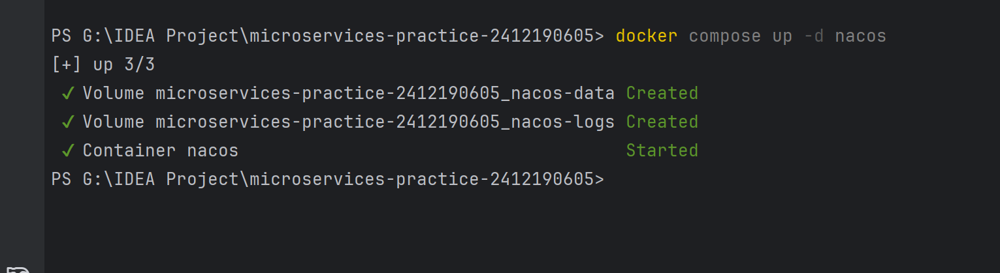
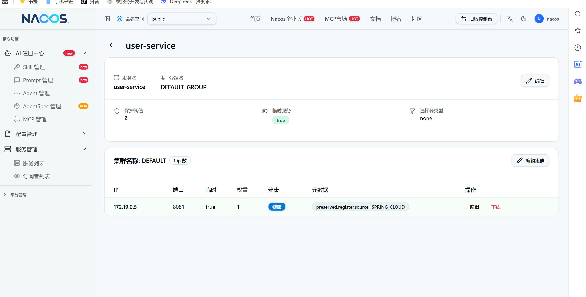
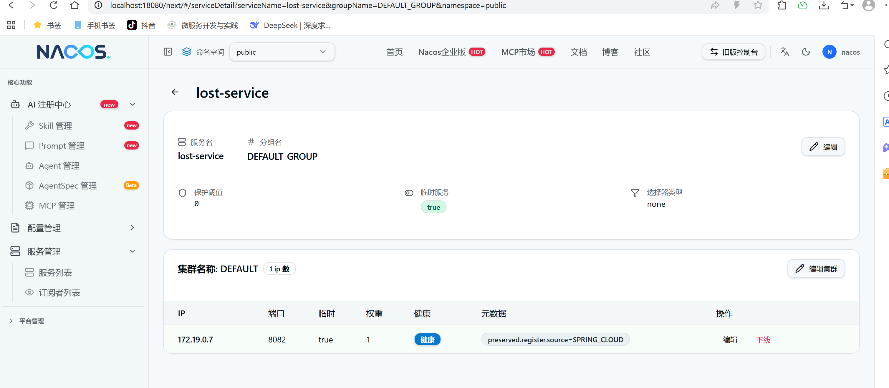
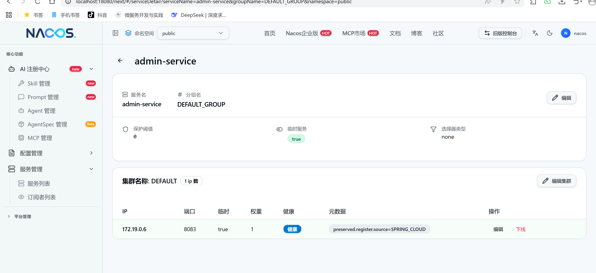

# 第七周：部署 Nacos 并注册服务

## 1. 部署内容

在根目录 `compose.yaml` 中新增 `nacos` 服务，镜像为 `nacos/nacos-server:v3.2.4`，单机模式（`MODE=standalone`）。

| 配置项 | 取值 | 说明 |
| --- | --- | --- |
| 镜像 | `nacos/nacos-server:v3.2.4` | 与作业指定版本一致 |
| 运行模式 | `MODE=standalone` | 单机部署 |
| 鉴权 | `NACOS_AUTH_ENABLE=true` | 开启 Nacos 鉴权 |
| Token 密钥 | `NACOS_AUTH_TOKEN` | Base64 字符串，由本地 `.env` 提供 |
| server identity | `NACOS_AUTH_IDENTITY_KEY` / `NACOS_AUTH_IDENTITY_VALUE` | 由本地 `.env` 提供 |
| 数据卷 | `nacos-data` → `/home/nacos/data`；`nacos-logs` → `/home/nacos/logs` | 保证重启后用户、服务数据不丢 |

### 端口规划（控制台 / 服务端 / SDK 三者分离）

| 用途 | 容器端口 | 宿主机端口 | 说明 |
| --- | --- | --- | --- |
| 控制台 UI | 8080 | **18080** | Nacos 3.x 控制台为独立端口，宿主机映射到空闲端口 18080 |
| 服务端 HTTP API | 8848 | 8848 | 服务注册与发现接口 |
| 客户端 gRPC | 9848 | 9848 | SDK 长连接端口（8848 + 1000） |

三个端口均只绑定 `127.0.0.1`，不暴露到局域网或公网。

## 2. 首次初始化（管理员密码）

1. 先单独启动 Nacos：`docker compose up -d nacos`（此时不要同时启动业务服务）。
2. 浏览器打开 <http://localhost:18080>，首次进入会要求初始化管理员密码，用户名固定为 `nacos`。
3. 初始化完成后用该账号登录控制台，并把同一密码写入本机 `.env` 的 `NACOS_PASSWORD`（`compose.yaml` 会把它注入到三个业务服务，供注册时鉴权使用）。

> 真实密码只存在于本地 `.env`，`.gitignore` 已忽略该文件；仓库中仅保留 `.env.example` 占位模板，README、文档和截图均不含明文密码。



## 3. 启动命令（先 Nacos，后业务服务）

```bash
# 1) 先启动 Nacos 并完成上面的初始化
docker compose up -d nacos

# 2) 再构建并启动三个业务服务，启动后自动注册
docker compose up -d --build user-service lost-service admin-service
```

## 4. 服务注册配置

三个服务均在 `src/main/resources/application.yml` 中配置了发现与注册信息：

```yaml
spring:
  application:
    name: user-service        # 分别为 user-service / lost-service / admin-service
  cloud:
    nacos:
      discovery:
        server-addr: ${NACOS_SERVER_ADDR:nacos:8848}
        username: ${NACOS_USERNAME:nacos}
        password: "${NACOS_PASSWORD:}"
        group: DEFAULT_GROUP
        register-enabled: true
```

要点：

*   服务名直接使用各自的 `spring.application.name`，与 `docs/microservices-design.md` 一致。
*   容器内访问 Nacos 使用服务名 `nacos:8848`，不能用 `localhost`。
*   宿主发布端口保持 8081 / 8082 / 8083，互不冲突。
*   依赖由 BOM 统一管理：Spring Cloud `2025.1.4` + Spring Cloud Alibaba `2025.1.0.0`，只声明 `spring-cloud-starter-alibaba-nacos-discovery`，不单独覆盖 nacos-client 版本，本周未引入 Config Starter。

> 说明：项目基线是 Spring Boot 4.1.2，原先的 Spring Cloud 2024.0.0 / Spring Cloud Alibaba 2023.0.3.2 分别对应 Boot 3.4 / 3.2 基线，跨大版本无法启动，因此升级到 2025.1.4 / 2025.1.0.0（后者自带 nacos-client 3.1.1，与服务端 3.2.4 匹配）。

## 5. 注册结果

Nacos 控制台「服务管理 → 服务列表」可见 3 个业务服务，实例数均为 1。

| 服务名 | 分组 | 实例 IP | 端口 | 健康 | 临时实例 |
| --- | --- | --- | --- | --- | --- |
| user-service | DEFAULT_GROUP | 172.19.0.5 | 8081 | 健康 | true |
| lost-service | DEFAULT_GROUP | 172.19.0.7 | 8082 | 健康 | true |
| admin-service | DEFAULT_GROUP | 172.19.0.6 | 8083 | 健康 | true |

实例详情截图：

| 服务 | 截图 |
| --- | --- |
| user-service（172.19.0.5:8081） |  |
| lost-service（172.19.0.7:8082） |  |
| admin-service（172.19.0.6:8083） |  |

> 实例 IP 为容器在 `micro-net` 网络内的地址；从宿主机访问服务仍用 8081 / 8082 / 8083。

## 6. 验证方式

```bash
# 容器状态
docker compose ps

# 注册日志（三个服务各一条 register finished）
docker compose logs user-service lost-service admin-service | grep "register finished"
```

三个服务启动日志中的关键输出：

```
nacos registry, DEFAULT_GROUP user-service 172.19.0.5:8081 register finished
nacos registry, DEFAULT_GROUP lost-service 172.19.0.7:8082 register finished
nacos registry, DEFAULT_GROUP admin-service 172.19.0.6:8083 register finished
```

命令行核对（需使用本机 `.env` 中的管理员密码）：

```bash
# 登录取 accessToken
curl -s -X POST 'http://localhost:8848/nacos/v1/auth/login' \
  -d 'username=nacos&password=<本地 .env 中的 NACOS_PASSWORD>'

# 服务列表（Nacos 3.x 控制台管理接口）
curl -s 'http://localhost:8848/nacos/v3/admin/ns/service/list?pageNo=1&pageSize=10&accessToken=<accessToken>'
```

