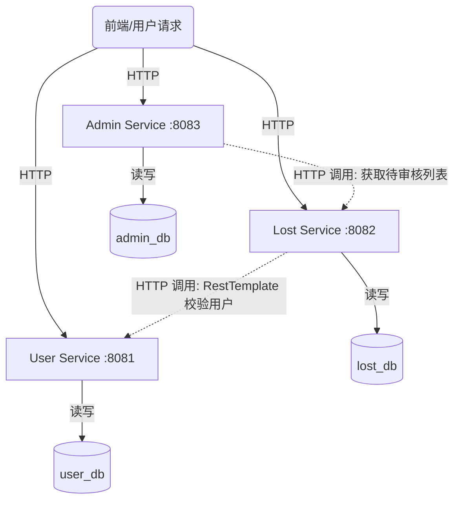

# 校园失物招领系统 - 微服务架构设计文档

## 1. 单体模块到微服务的拆分映射
原单体应用（monolith）中的所有业务逻辑都集中在一个工程和一个数据库中。重构后，我们按照“业务能力”和“单一职责”原则，将其拆分成了 3 个核心微服务：
*   **原用户模块** 独立为 `user-service`。
*   **原失物发布/检索模块** 独立为 `lost-service`。
*   **原审核/统计模块** 独立为 `admin-service`。

## 2. 微服务职责与数据归属
每个微服务都遵循**数据私有化**原则，拥有独立的数据库和表，禁止跨服务直连数据库。

| 服务名称          | 端口 | 职责范围                                       | 独立数据库 | 拥有的数据表                 |
| :---------------- | :--- | :--------------------------------------------- | :--------- | :--------------------------- |
| **user-service**  | 8081 | 负责师生账号的注册、登录及基础信息维护。       | `user_db`  | `users` (用户表)             |
| **lost-service**  | 8082 | 负责失物启事和招领启事的发布、条件检索。       | `lost_db`  | `lost_items` (失物表)        |
| **admin-service** | 8083 | 负责对发布的帖子进行审核、认领核验及数据统计。 | `admin_db` | `audit_records` (审核记录表) |

## 3. 服务之间的调用关系与数据交互
*   **跨服务协作**：当 `lost-service` 接收到发布失物的请求时，需要验证发布者是否合法。`lost-service` 会通过 `RestTemplate` 发送 HTTP GET 请求调用 `user-service` 的 `/api/users/{id}` 接口。
*   **数据关联原则**：`lost-service` 的 `lost_items` 表中**不建立跨库外键**，仅保存 `userId`。`admin-service` 审核时，同样只保存 `lostItemId`，通过 API 调用获取详情。
*   **容错机制**：如果远程调用失败（如网络超时或目标服务宕机），调用方必须通过 `try-catch` 捕获异常，并执行降级逻辑（如返回错误提示），防止雪崩效应。

## 4. 架构图 (Mermaid)

